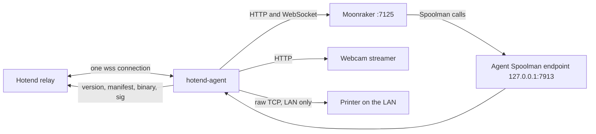

# hotend-agent: how it is built

A single static Go binary (Go 1.22, one dependency, `gorilla/websocket`) that runs on a printer host and bridges the Hotend relay to the local Moonraker. It dials out to the relay over one WebSocket and answers what the relay asks for. It listens on no internet port. <!-- src: go.mod, main.go:1-4, README.md:49 -->

## Components

- Agent: `main.go`, `package main`. Startup is `main` (probation check, update loop, relay URL check, state load, background workers, then a reconnect loop). <!-- src: main.go:269-323 -->
- Relay connection: `connect` dials the relay, pings every 30 s with a 70 s read deadline and hands each frame to `dispatch`. <!-- src: main.go:779-854, main.go:864-948 -->
- Request proxy: `doFetch` forwards a relay request to Moonraker or the webcam and streams the answer back. `doWSOpen` does the same for a Moonraker WebSocket. <!-- src: main.go:1018-1090, main.go:1722-1744 -->
- LAN tunnels: `doTCPOpen` opens raw TCP to a host and port the relay names, limited to private, loopback and link-local addresses. <!-- src: main.go:950-1005 -->
- Webcam: `detectWebcam` asks Moonraker's webcam list, then probes common MJPEG and HLS paths, and `reportDetectedWebcam` tells the relay. `buildWebcamURL` and `buildWebcamHLS` build the fetch URL from the configured base. <!-- src: main.go:1176-1229, main.go:1287-1381 -->
- Spoolman: a local endpoint on `127.0.0.1` (`serveSpoolman`), the `/server/spoolman/*` emulation (`handleMoonrakerSpoolman`), the active-spool sync into Moonraker and agent-side usage counting from `print_stats` (`trackFilament`). <!-- src: main.go:1092-1160, main.go:1444-1669 -->
- Self-update and rollback: `updateLoop`, `selfUpdate`, `fetchReleaseManifest`, `signedByTrustedKey`, `checkPendingUpdate`, `watchPendingUpdate`, `revertTo` and `restartSelf`. <!-- src: main.go:325-755 -->
- `verify-sig/`: a dependency-free ed25519 checker for the installer's first install. It takes a file, a hex signature file and one or more hex public keys, and exits 1 unless one key verifies. <!-- src: verify-sig/main.go:1-57 -->
- Scripts: `stub-relay.mjs` (stand-in relay and Moonraker), `verify-agent-release.mjs` (checks what the relay serves) and `gate-mutation.mjs` (mutation testing report for the merge gate). <!-- src: scripts/stub-relay.mjs:1-10, scripts/verify-agent-release.mjs:1-20, scripts/gate-mutation.mjs:1-16 -->
- `systemd/hotend-agent.service`: an example system unit for hand installs, run as a non-root user with `NoNewPrivileges`. <!-- src: systemd/hotend-agent.service -->
- CI in `.github/workflows/`: `ci.yml` (gofmt, vet, builds, tests, stub-relay run), `reproducible.yml` (rebuilds a published release and compares bytes) and `upkeep.yml` (weekly link and dossier drift checks). <!-- src: .github/workflows/ci.yml, .github/workflows/reproducible.yml, .github/workflows/upkeep.yml -->
- Not in this repository: the relay, the app and the installer script. <!-- src: README.md:82, CONTRIBUTING.md:7 -->

## Data flow

- Start: `main` runs `checkPendingUpdate` and starts `updateLoop` first, then exits unless `HOTEND_RELAY_URL` is set and is `wss://` (or `ws://` to 127.0.0.1 or localhost), loads state, and starts the probation watcher, Spoolman endpoint, filament tracking and webcam detection. It then calls `connect` in a loop, with a pause that starts at 1 s and doubles while it is under 30 s. <!-- src: main.go:274-322 -->
- Connect: the agent dials `<relay>/__relay/agent?printer=<id>`, adding `&claim=<token>` while `HOTEND_CLAIM` is set, with the version in `X-Hotend-Agent-Version` and the device secret as a bearer token when it has one. <!-- src: main.go:779-796 -->
- Request: the relay sends `req`, then `body` chunks, then `end`. The agent builds the local URL, strips forwarding and auth headers, calls Moonraker (or the webcam when the request targets it) and replies with `res`, `body` chunks and `end`. A `cancel` frame aborts the fetch. <!-- src: main.go:898-917, main.go:1007-1090 -->
- Spoolman: requests under `/server/spoolman/` are answered by the agent from the central store over the relay (`sm` out, `smres` back), and never reach Moonraker. <!-- src: main.go:1018-1026, main.go:1411-1504 -->
- Moonraker WebSocket: `wsopen` dials Moonraker, `wsmsg` writes into it, frames from Moonraker go back as `body`, and `wsclose` ends it. <!-- src: main.go:918-935, main.go:1722-1744 -->
- Tunnel: `tcpopen` resolves and checks the host, dials the checked IP with a 10 s timeout, answers `tcpready` or `tcperr`, then pumps `tcpdata` both ways until `tcpclose`. <!-- src: main.go:936-946, main.go:972-1005 -->
- Config frames: `config` sets or clears the webcam URL override, and `device-secret` stores the secret in the state file. <!-- src: main.go:870-890 -->
- Update: about every 6 hours plus up to an hour of jitter, the agent reads `/agent-bin/version`, ignores anything not strictly newer or already blacklisted, checks the signed manifest, downloads the binary, checks its hash, size and signature, test-runs it with `-version`, keeps the old binary as `.prev`, marks probation, renames the new binary in and execs it. <!-- src: main.go:344-355, main.go:590-722 -->
- Probation ends on the first relay connection. Otherwise `revertTo` restores `.prev`, blacklists the version and restarts. <!-- src: main.go:799-807, main.go:375-427, main.go:464-492 -->

## Storage

- State file: JSON at `$XDG_CONFIG_HOME/hotend/agent.json`, or `~/.config/hotend/agent.json`, or the path in `HOTEND_AGENT_STATE`. It holds `printerId`, `deviceSecret`, `pendingVersion`, `pendingSince`, `pendingBoots` and `badVersions`. The file is written with mode `0600` in a `0700` directory. <!-- src: main.go:82-89, main.go:188-199, main.go:236-242 -->
- Legacy state at `~/.hotend-agent/agent.json` and `~/.hotend-agent.json` is read when the durable path has no identity, and never written. <!-- src: main.go:91-98, main.go:206-225 -->
- Next to the running binary: `<binary>.new` while an update is verified, and `<binary>.prev`, the copy a rollback restores. <!-- src: main.go:692-709, main.go:462-492 -->
- No database, cache or log file. Everything else is in memory, and the agent writes to stdout and stderr only. <!-- src: main.go:134-166 -->
- No analytics. <!-- src: README.md:62 -->

## Auth

- Agent to relay: the device secret, issued by the relay in a `device-secret` frame, goes in an `Authorization: Bearer` header and never in the URL. The claim token goes in the URL on the first connect. <!-- src: main.go:140-143, main.go:779-796, main.go:881-890 -->
- The relay URL must be `wss://`, with `ws://` only for 127.0.0.1 and localhost. <!-- src: main.go:285-289 -->
- Relay to agent: there is no allowlist of Moonraker paths or methods. The agent checks only that a path starts with a single `/`, then sends it to `HOTEND_LOCAL_URL` as a local client with forwarding, `Authorization` and `Origin` headers stripped. <!-- src: main.go:100-108, main.go:1383-1409 -->
- Webcam: the relay can set the URL, and it is not checked against private ranges. <!-- src: main.go:870-880, main.go:1181-1197 -->
- Tunnels: only hosts whose every resolved address is private, loopback or link-local, on ports 1 to 65535. <!-- src: main.go:959-982 -->
- Spoolman endpoint: bound to `127.0.0.1`, no authentication, and WebSocket upgrades accept any origin. <!-- src: main.go:1096-1106 -->
- Updates: accepted only with a valid ed25519 signature from one of two public keys compiled into `main.go`, over the binary and over a manifest that binds the version to each architecture's sha256. A manifest that returns 404 falls back to the per-binary signature alone. <!-- src: main.go:39-57, main.go:546-583, main.go:630-691 -->
- The agent runs as whichever user starts it and needs no privileges. <!-- src: systemd/hotend-agent.service:12-17 -->

## External services

- The Hotend relay at `HOTEND_RELAY_URL`: WebSocket `/__relay/agent`, and over HTTP `/agent-bin/version`, `/agent-bin/manifest`, `/agent-bin/manifest.sig`, `/agent-bin/hotend-agent-linux-<arch>` and its `.sig`. <!-- src: main.go:436, main.go:547-562, main.go:606-677, main.go:780 -->
- Moonraker at `HOTEND_LOCAL_URL` (default `http://127.0.0.1:7125`): the relayed requests plus `/server/config`, `/server/webcams/list`, `/websocket` and `/server/spoolman/spool_id`. <!-- src: main.go:73, main.go:1291, main.go:1556, main.go:1595, main.go:1622 -->
- The webcam streamer at `HOTEND_WEBCAM_URL` (default `http://127.0.0.1:8080`), plus the detected URL. <!-- src: main.go:74, main.go:161-177 -->
- LAN hosts the relay asks for through a tunnel. <!-- src: main.go:972-988 -->
- Other environment variables: `HOTEND_CLAIM`, `HOTEND_AGENT_STATE`, `HOTEND_SPOOLMAN_PORT`, `HOTEND_AGENT_AUTO_UPDATE` (`off`, `0`, `false` or `no` disables self-update) and `XDG_CONFIG_HOME`. <!-- src: main.go:75-89, main.go:136, main.go:595-598 -->
- CI only: GitHub Actions, the lychee link checker and dossier-scribe, with `GITHUB_TOKEN`. <!-- src: .github/workflows/upkeep.yml:20-80 -->

## Unverified

- Relay behaviour, the installer script, and how releases are built, signed and published are outside this repository.
- Messages the relay sends that are not in `dispatch` are ignored by the agent, but the relay's side of the protocol was not read.

## Generated facts

<!-- auto:start -->
- go module: hotend-agent
- go version: 1.22
- go requires (1): github.com/gorilla/websocket
<!-- auto:end -->
